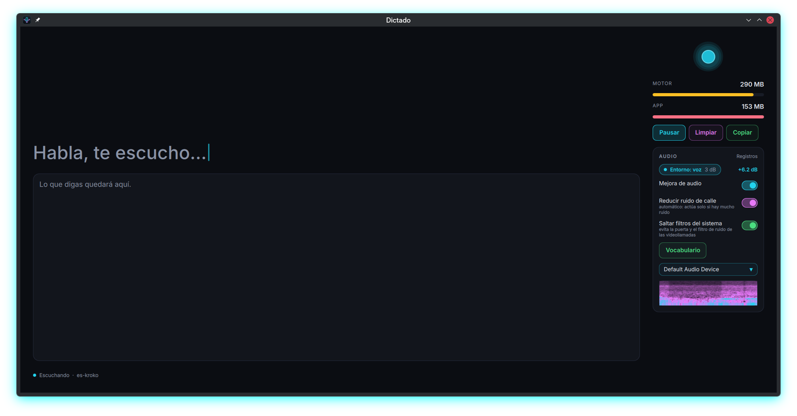

# Dictado

Dictado en tiempo real, local y sin conexión: abre el micrófono al iniciar y muestra lo que dices
mientras lo dices (texto parcial vivo en cian y líneas finales al cerrar la frase). Idioma: es-CO.



- Motor y ventana en procesos separados, cada uno con su medidor de memoria (RAM).
- Cadena de audio: micrófono directo (Linux: salta los filtros del sistema como EasyEffects), canal con mejor
  SNR, remuestreo sinc, pasa-altos de 80 Hz, detector de voz neuronal y nivelación con los últimos 15 s.
- Vocabulario propio editable (`QA = cu a, cuba`) con corrección por sonido parecido.
- Espectrograma, selector de micrófono, registros de diagnóstico sin el texto dictado.

## Control de cambios

| Versión | Fecha | Autor | Descripción |
|---|---|---|---|
| 0.1.0 | 2026-10-04 | Andrés García | Primera versión: motor, interfaz, medidor de RAM separado |
| 0.2.0 | 2026-10-06 | Andrés García | Mejora de audio, detector de voz, registros, micrófono directo, vocabulario, icono |

## Cómo funciona

Dos procesos, para que la RAM salga separada de verdad y un fallo del motor no tumbe la interfaz:

- `dictado-motor` (Rust): captura el micrófono con cpal y reconoce con sherpa-onnx (zipformer streaming
  es-kroko). Emite una línea JSON por evento (`listo`, `parcial`, `final`, `nivel`, `error`).
- `dictado` (Rust + Qt 6 con cxx-qt): lanza el motor, pinta la interfaz QML y mide la memoria residente
  de cada proceso con `sysinfo`. Si el motor cae, lo relanza hasta 3 veces seguidas.

Motor elegido tras comparar alternativas: whisper (634 MB, sin streaming), vosk-small (WER 25-33 %),
Parakeet (más de 1 GB). Sherpa zipformer: unos 285 MB, parciales tipo teclado de Android.

## Compilar y ejecutar

Requisitos: Rust 1.85 o superior, Qt 6 con `qt6-declarative-dev` (Linux), `libasound2-dev`.

```
cargo build --release          # tarda la primera vez (descarga sherpa estático)
target/release/dictado         # busca dictado-motor junto al ejecutable
```

Modelo (unos 150 MB, no viaja en el repositorio): variable `DICTADO_MODELO`, si no
`<datos del usuario>/dictado/modelos/es-kroko` y, como último recurso, `~/.cache/sherpa/es-kroko`.

```
D=~/.cache/sherpa/es-kroko; mkdir -p "$D"
U=https://huggingface.co/csukuangfj/sherpa-onnx-streaming-zipformer-es-kroko-2025-08-06/resolve/main
for f in encoder.onnx decoder.onnx joiner.onnx tokens.txt; do curl -L -o "$D/$f" "$U/$f"; done
```

Instalar para el usuario (Linux, sin sudo): `bash scripts/instalar.sh` deja la app en `~/.local/opt/dictado`,
el icono y la entrada "Dictado" en el menú. `bash scripts/instalar.sh --quitar` la retira.

## Vocabulario

`<configuración del usuario>/dictado/vocabulario.txt` (Linux `~/.config`), una línea por término:
`QA = cu a, cuba, kiu ei`. Las variantes se reemplazan siempre y las palabras que suenan parecido se corrigen
solas en frases de 1 a 3 palabras. Se recarga al guardar; el botón "Vocabulario" lo abre.

## Atajos

Espacio: pausar o reanudar · Ctrl+L: limpiar · Ctrl+C: copiar el historial · F11: pantalla completa.
La ventana recuerda tamaño, posición y estado maximizado.

## Componentes QML

Cada componente de `qml/componentes/` se ve por separado: `qml6 qml/componentes/vista-Orbe.qml`.
`qml/Prueba.qml` abre toda la ventana con datos simulados, sin motor.

## Pruebas

```
bash tests/motor-wav.sh         # motor con un WAV, sin micrófono
bash tests/gui-offscreen.sh     # interfaz sin pantalla con motor simulado
bash scripts/pipeline.sh        # fmt, clippy, build y prueba de interfaz
```

Variables de diagnóstico de la interfaz: `DICTADO_DEPURA=1`, `DICTADO_MOTOR=ruta`, `DICTADO_AUTOSALIR=N`.

## Diagnóstico

Cada proceso escribe su registro en `<estado del usuario>/dictado/registros/` (Linux `~/.local/state`,
macOS `~/Library/Application Support`, Windows `%LOCALAPPDATA%`): `motor.log` y `gui.log`, con rotación
de 1 MB por archivo y 3 copias. La interfaz tiene un botón "Registros" que abre esa carpeta.

- Formato: `hora-local-con-milisegundos Nivel módulo clave=valor`, una línea por hecho.
- Nivel: `DICTADO_LOG=error|aviso|info|depura` (por defecto `info`). En `depura` el motor resume cada 5 s
  (RMS, pico, ganancia, bloques por segundo y tiempo de decodificación). `DICTADO_LOG_STDERR=1` repite en la terminal.
- Qué queda: arranque y carga del modelo, dispositivo (tasa, canales, formato, buffer), errores de cpal, desbordes,
  órdenes recibidas, cambios de micrófono, relanzamientos del motor con su código de salida, RAM cada 30 s y el cierre.
- Privacidad: el texto dictado nunca se registra, solo longitudes y conteos.
- `bash scripts/diagnostico.sh [líneas]` imprime la ruta, los últimos errores y avisos de ambos registros y los relanzamientos.
- Las pruebas redirigen los registros a una carpeta temporal con `XDG_STATE_HOME`; para no tocar los reales haga lo mismo.

## Licencia

Código bajo licencia MIT (ver `LICENSE`). El modelo de voz se descarga aparte y conserva la licencia de su autor.
